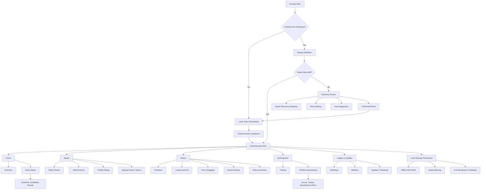
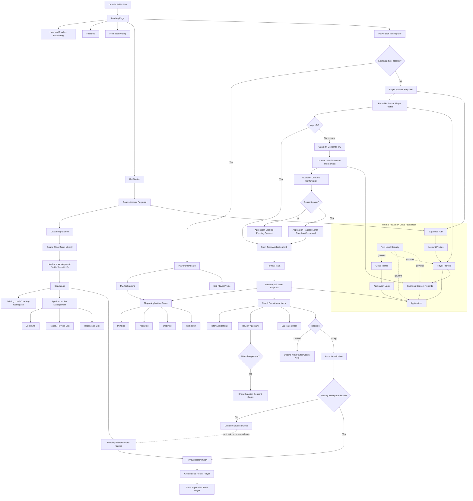
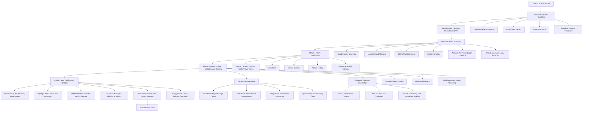

# Dumala Web App Flowcharts

Updated: 2026-06-24 (optimized pass)

These diagrams align the planned SaaS/recruitment direction with the current Dumala architecture.

The existing product is a local-first React/Vite coaching workspace. Accounts, cloud teams, player applications, role-based access, payments, chat, and league administration are future capabilities, so they should be shown as planned flows rather than current app behavior.

**Changes in this pass:**
1. MVP chart — added guardian/parental consent path for minors (replaces the hard 18+ block, which previously locked out most grassroots players).
2. MVP chart — added the cloud-to-local sync-back edge so accepted players don't get stranded when a coach decides on a non-primary device.
3. MVP chart — added a returning-player sign-in branch (dashboard with application statuses), not just first-time signup.
4. New standalone chart — **Public Player Profiles & Highlights**, including FPRDS-verified attributes as a differentiator versus a generic social feed.
5. Roadmap chart — Phase 5 now references the new standalone chart and is broken into sub-items consistent with the other phases.

## Current App Flow

Paste this chart into Mermaid Live to show what Dumala supports today. (Unchanged — this is accurate documentation of the existing local-first app.)

## Planned SaaS Landing Page and Recruitment MVP

Paste this chart into Mermaid Live to show the next planned product direction before full Phase 3 sync.

## Planned: Public Player Profiles & Highlights

Paste this chart into Mermaid Live. This is a standalone planned flow, separate from the recruitment MVP, focused on a public-facing, social-style player profile with highlight videos. It's designed to layer on top of the Phase 3A identity foundation and the existing FPRDS data, not replace either.

The differentiator versus a generic "Instagram for athletes" product: profiles can surface **coach-verified FPRDS attribute scores** alongside highlight reels, so coaches and scouts get real signal, not just curated clips.

```mermaid
flowchart TD
    A[Player Account] --> B[Public Profile Setup]

    B --> C[Basic Info]
    C --> C1[Name, Position, Age Group, Location]
    C --> C2[Team History]

    B --> D[Highlight Reel]
    D --> D1[Upload Video Clip]
    D1 --> D2[Auto Thumbnail and Compression]
    D2 --> D3{Moderation Check}
    D3 -- Flagged --> D4[Manual Review Queue]
    D3 -- Passed --> D5[Published to Highlight Reel]
    D --> D6[Reorder / Pin Best Clip]
    D --> D7[Tag Clip: Skill, Match, Position]

    B --> E[FPRDS Verified Attributes]
    E --> E1{Has FPRDS Assessment History?}
    E1 -- Yes --> E2[Opt In to Show Verified OVR and Attributes]
    E1 -- No --> E3[Prompt: Get Assessed by a Dumala Coach]
    E2 --> E4[Verified Badge: Coach-Administered Score]
    E2 --> E5[Attribute Radar Snapshot]

    B --> F[Visibility Controls]
    F --> F1{Player is a minor?}
    F1 -- Yes --> F2[Restricted Defaults: No Location Pin, Guardian-Managed Visibility]
    F1 -- No --> F3[Standard Visibility Defaults]
    F2 --> F4[Guardian Can Edit / Take Down Profile]
    F --> F5[Public / Team-Only / Private Toggle]

    B --> G[Published Public Profile]
    G --> G1[Shareable Profile Link]
    G --> G2[Embed in Team Application Snapshot]

    G --> H[Discovery and Search Surface]
    H --> H1[Browse by Position]
    H --> H2[Browse by Age Group / Location]
    H --> H3[Filter by Verified Attribute Range]
    H --> H4[Coach / Scout Shortlist]

    H4 --> I[Shortlist Actions]
    I --> I1[Save to Watchlist]
    I --> I2[Invite to Apply via Application Link]
    I --> I3[Request Trial]

    G --> J[Engagement Layer]
    J --> J1[Profile Views Counter]
    J --> J2[Follow a Player]
    J --> J3[Reactions on Highlight Clips]

    G --> K[Reporting and Moderation]
    K --> K1[Report Clip or Profile]
    K1 --> K2[Trust and Safety Review Queue]
    K2 --> K3{Action}
    K3 -- Remove Content --> K4[Clip or Profile Takedown]
    K3 -- Warn --> K5[Warning to Player / Guardian]
    K3 -- No Action --> K6[Report Closed]

    subgraph ProfileFoundation[Phase 5 Cloud Additions]
        PF1[Public Profile Records]
        PF2[Highlight Media Storage and CDN]
        PF3[Moderation Queue]
        PF4[Verified Attribute Snapshot Cache]
        PF5[Guardian Permission Records]
        PF6[Discovery Index]

        PF1 --> PF2
        PF1 --> PF4
        PF1 --> PF5
        PF2 --> PF3
        PF1 --> PF6
    end

    C --> PF1
    D1 --> PF2
    D3 --> PF3
    E2 --> PF4
    F2 --> PF5
    H --> PF6
```

## Later Roadmap Flow

Paste this chart into Mermaid Live to show the bigger roadmap. This is intentionally separate from the MVP because these features require full cloud sync, permissions, privacy, and collaboration design.

