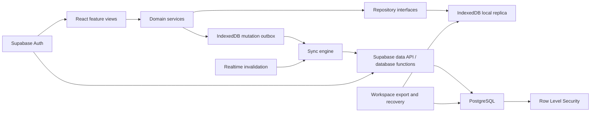
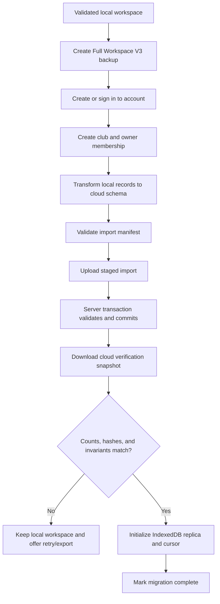

# Phase 3: Cloud Accounts and Synchronization Implementation Plan

Updated: 2026-06-23

Status: Proposed implementation plan

## 1. Executive summary

Phase 3 should add secure accounts, durable cloud storage, and cross-device synchronization without sacrificing Dumala's existing offline-first behavior or risking the browser data users already own.

The recommended architecture is:

- Keep the React 19, Vite, TypeScript, PWA, and Vercel frontend.
- Use Supabase as the managed backend platform.
- Use PostgreSQL as the durable relational database.
- Use Supabase Auth with email OTP or magic-link sign-in for the first release.
- Use PostgreSQL Row Level Security as the mandatory authorization boundary.
- Keep a validated local replica on the device.
- Move the local sync replica and mutation queue to IndexedDB.
- Treat the cloud database as the durable shared source of truth after migration.
- Use an idempotent outbox, record versions, tombstones, and optimistic concurrency instead of silent last-write-wins updates.
- Preserve Full Workspace V3 export and local rollback throughout migration.
- Prepare club memberships and roles in the schema now, while deferring collaboration UI to Phase 4.

This approach meets the Phase 3 completion criterion:

> A user can sign in on another device and safely access the same club data.

It also creates the authorization and data foundations needed by Phase 4 collaboration and Phase 5 controlled public profiles.

## 2. Current state and constraints

Dumala is currently a static local-first PWA:

- The browser owns all application state and business interactions.
- Core records are persisted through a typed `localStorage` service.
- Runtime validation uses Zod.
- Full Workspace V3 backup includes the complete known workspace.
- Startup recovery blocks unsafe writes when stored data is malformed.
- The application works offline through its service worker and precached shell.
- There is no application API, account system, cloud database, or shared ownership model.
- Vercel deploys the validated static build after protected GitHub CI succeeds.

Phase 3 must preserve these strengths while addressing:

- cross-device access
- durable recovery when a device is lost
- authenticated ownership
- interrupted and repeated synchronization
- offline changes
- duplicate writes
- conflicting edits
- account recovery and deletion
- operational monitoring and backups

## 3. Goals

### Product goals

1. A user can create an account or sign in securely.
2. An existing local workspace can be uploaded without deleting or replacing its local source.
3. The same user can sign in on another device and download the workspace.
4. The application remains usable while temporarily offline.
5. Offline changes synchronize after reconnection.
6. Interrupted or repeated synchronization does not duplicate domain records.
7. Conflicts never silently overwrite newer data.
8. Users can export and delete their data.
9. Support can diagnose synchronization failures without receiving private workspace contents by default.
10. Phase 4 roles and invitations can be added without redesigning the core database.

### Engineering goals

1. Separate domain state, local persistence, synchronization, and UI concerns.
2. Preserve current Zod validation at every untrusted boundary.
3. Make database migrations reproducible and reviewable in source control.
4. Enforce authorization in PostgreSQL, not only in the React client.
5. Make every mutation idempotent and traceable.
6. Establish measurable service health, backup, recovery, and security controls.
7. Roll out cloud sync behind an explicit feature flag and staged migration.

## 4. Non-goals

The following should not be included in Phase 3 unless required to complete a safe foundation:

- multi-user invitations and membership management UI
- full Owner, Admin, Coach, Staff, and Viewer behavior
- simultaneous collaborative editing
- public player, staff, or club profiles
- public media hosting
- multiple squads per club
- Google Play packaging
- replacing the PWA with native applications
- custom-built authentication or cryptography
- CRDT-based collaborative document editing

The database should be ready for future memberships and roles, but Phase 3 should expose one active owner-controlled club workspace per account in the UI.

## 5. Recommended platform

### 5.1 Recommended selection

| Concern | Selection |
| --- | --- |
| Frontend | Existing React 19 and Vite PWA |
| Frontend hosting | Existing Vercel deployment |
| Backend platform | Supabase managed platform |
| Database | Managed PostgreSQL |
| Authentication | Supabase Auth |
| Initial sign-in | Email OTP or magic link |
| Authorization | PostgreSQL Row Level Security |
| Cloud API | Supabase generated data API plus narrowly scoped database functions |
| Local replica | IndexedDB |
| Local schema validation | Existing Zod schemas |
| Synchronization | Client outbox, pull cursor, record versions, and idempotent server mutations |
| Realtime | Optional invalidation signal after baseline sync is proven |
| Error monitoring | Application error monitoring plus Supabase operational logs |
| Analytics | Privacy-minimized operational events only |
| Backups | Managed daily backups plus scheduled logical off-site exports |

### 5.2 Why Supabase fits Dumala

Supabase is the strongest fit because Dumala's data is relational:

- clubs own players, staff, matches, assessments, standings, bulletins, schedules, and tactics
- memberships connect users to clubs
- assessments and match histories require durable relationships
- future reporting needs joins and reliable transactions
- authorization must consistently filter records by club membership

PostgreSQL gives Dumala:

- foreign keys and check constraints
- transactions for multi-record business operations
- unique constraints for duplicate prevention
- indexes for club-scoped queries
- Row Level Security for tenant isolation
- mature backup and migration tooling
- a portable data model that reduces platform lock-in

Supabase adds managed Auth, APIs, Realtime, logs, and backups without requiring Dumala to operate a custom application server immediately.

### 5.3 Supabase advantages

- PostgreSQL is well suited to Dumala's connected domain model.
- Row Level Security can enforce club isolation at the database boundary.
- Auth and database identities integrate directly.
- SQL migrations can be committed and tested.
- Transactions can preserve match, standings, and player-stat invariants.
- The browser may use a publishable client key safely when RLS is complete.
- Standard PostgreSQL tools keep the data portable.
- Realtime can later notify devices that cloud records changed.
- Managed infrastructure reduces initial operational load.

### 5.4 Supabase disadvantages and mitigations

| Disadvantage | Mitigation |
| --- | --- |
| The web client does not receive Firestore-style offline synchronization automatically. | Build a deliberately small IndexedDB replica and outbox with domain-specific conflict rules. |
| Incorrect RLS policies can expose or block data. | Deny by default, test policies in CI, index policy columns, and never rely on client-side checks alone. |
| Direct browser-to-database APIs can spread query logic through components. | Hide Supabase behind repository and sync service interfaces. |
| Managed service usage creates provider dependency. | Keep standard PostgreSQL schemas and migrations; avoid provider-only logic where it has no clear value. |
| Free-tier recovery guarantees are insufficient for production data. | Use a production plan with documented backups and independent logical exports before launch. |
| Realtime adds complexity and connection cost. | Treat Realtime as an invalidation hint, not the source of correctness, and add it only after pull/push sync is stable. |

## 6. Alternatives considered

### 6.1 Firebase Authentication and Cloud Firestore

**Pros**

- Mature client SDKs.
- Built-in offline persistence.
- Automatic synchronization is fast to prototype.
- Strong global infrastructure and emulator tooling.

**Cons**

- Firestore's document model is less natural for Dumala's relational records and reporting.
- Complex club membership and authorization rules are harder to reason about than PostgreSQL RLS.
- Multi-record invariants and joins require denormalization or additional application logic.
- Built-in offline behavior commonly resolves multiple changes with last-write-wins semantics, which is unsafe for high-value coaching records without added conflict controls.
- Query and data-model choices can increase platform lock-in.

**Decision**

Do not select Firestore for the primary architecture. Its offline SDK is attractive, but Dumala benefits more from relational integrity, SQL reporting, transactional business rules, and membership-scoped RLS.

### 6.2 Custom API with PostgreSQL

Example stack: managed PostgreSQL, a Node API, an external identity provider, a queue, and object storage.

**Pros**

- Maximum control over API contracts and deployment.
- Clear server-only business layer.
- Easier to move between individual infrastructure providers.
- Can be tuned for complex enterprise requirements.

**Cons**

- Highest implementation and operational cost.
- Requires API hosting, authentication integration, patching, observability, scaling, and incident response.
- Delays the user-facing cross-device goal.
- Creates more security-critical code than the current team needs to own.

**Decision**

Defer a custom API until product scale or compliance requirements justify it. Supabase database functions or Edge Functions can cover narrowly privileged operations in the interim.

### 6.3 Cloud backup only, without synchronization

**Pros**

- Lowest technical complexity.
- Preserves the current local-first model.
- Provides device-loss recovery.

**Cons**

- Does not satisfy safe cross-device continuity.
- Creates ambiguous overwrite behavior between device snapshots.
- Cannot support Phase 4 collaboration.

**Decision**

Not sufficient for Phase 3, although cloud snapshots may be useful as an additional recovery mechanism.

## 7. Target architecture



### 7.1 Ownership boundaries

| Layer | Responsibility |
| --- | --- |
| React views | Render state, accept commands, show sync and recovery status |
| Domain services | Validate and execute business operations |
| Repository interfaces | Provide storage-independent CRUD contracts |
| IndexedDB repositories | Maintain the device replica and outbox |
| Sync engine | Push, pull, retry, deduplicate, and surface conflicts |
| Supabase client adapter | Authenticate and execute approved cloud operations |
| PostgreSQL | Durable records, constraints, transactions, versions, and audit metadata |
| RLS policies | Enforce tenant membership and operation permissions |
| Server functions | Execute privileged or multi-record operations atomically |

### 7.2 Source-of-truth policy

Before cloud migration:

- the validated local workspace remains authoritative

During migration:

- the local workspace is frozen only for the short upload transaction
- a Full Workspace V3 backup is generated
- cloud import is validated independently
- local data is retained unchanged

After successful migration:

- PostgreSQL is the durable source of truth
- IndexedDB is the device's working replica
- the outbox is the source of pending local intent
- `localStorage` is retained temporarily as a rollback source, then retired through a later controlled migration

The service worker remains responsible only for deployable application assets. It must not cache authenticated API responses, access tokens, or private workspace payloads.

## 8. Durable data model

### 8.1 Common record fields

Every cloud-synchronized domain table should normally include:

```text
id                 uuid primary key
club_id            uuid not null
created_at         timestamptz not null
created_by         uuid
updated_at         timestamptz not null
updated_by         uuid
version            bigint not null default 1
deleted_at         timestamptz
client_created_at  timestamptz
origin_device_id   uuid
```

Rules:

- Generate UUIDs on the client for offline-created records.
- Never use array position or display name as identity.
- Use `club_id` on all tenant-owned tables.
- Use `version` for optimistic concurrency.
- Use soft-delete tombstones where deletion must synchronize.
- Use database time for authoritative `created_at` and `updated_at`.
- Keep device time only as diagnostic metadata.

### 8.2 Identity and tenancy tables

#### `user_profiles`

- `user_id` references the authentication user
- display name
- locale and timezone
- account state
- consent and policy-version metadata
- created and updated timestamps

Do not copy authentication secrets into this table.

#### `clubs`

- stable UUID
- name, short name, and branding
- timezone
- owner user ID
- lifecycle state
- created and updated metadata

#### `club_memberships`

- club ID
- user ID
- role
- membership state
- invited, accepted, suspended, and removed timestamps
- unique constraint on `(club_id, user_id)`

Phase 3 creates the owner membership automatically. Phase 4 expands role behavior and invitation workflows.

#### `devices`

- user ID
- generated installation/device ID
- optional user-facing device label
- last sync timestamp
- app version
- revoked timestamp

Do not collect hardware identifiers, advertising identifiers, or unnecessary fingerprinting data.

### 8.3 Domain tables

Create normalized durable tables for:

- players
- staff members
- games and events
- match results
- match scorer contributions
- MVP awards
- standings rows
- bulletins
- assessment sessions
- assessment measurements
- development plans
- availability
- coach notes
- weekly training schedules
- weekly schedule history
- tactics workspaces
- tactics lineup assignments
- tactics drawings and paths
- player extras
- standings backups or snapshots where still product-relevant

Use JSONB only for bounded, versioned structures that do not benefit from relational querying, such as:

- tactics drawing geometry
- formation position layouts
- calculation snapshots retained for reproducibility
- immutable imported source metadata

Do not store the complete club workspace as one JSON document. A single document would make conflict detection, partial synchronization, authorization, indexing, and reporting harder.

### 8.4 Assessment reproducibility

Each assessment session must retain:

- raw measurements
- computed scores
- role and age group
- benchmark version
- weighting version
- scoring algorithm version
- generated development plan inputs

Historical assessment results must not change when benchmark tables are updated.

### 8.5 Database constraints

Use database constraints in addition to TypeScript and Zod:

- foreign keys for all relationships
- unique membership and idempotency keys
- non-negative scores and counts
- valid lifecycle states
- valid role values
- valid event/result combinations
- required club ownership
- check constraints for soft-delete and status combinations

Business operations that update several tables, such as recording or reversing a match result, should run in one database transaction through a reviewed database function.

## 9. Authentication approach

### 9.1 Initial sign-in method

Use email OTP or magic-link authentication for the Phase 3 release.

**Advantages**

- no passwords to store or reset
- lower account-support burden
- good fit for an installed PWA
- short implementation path
- email ownership supplies a recovery channel

**Disadvantages**

- depends on email deliverability
- users need temporary inbox access
- magic links require correct deep-link and redirect handling
- shared email accounts remain an organizational risk

### 9.2 Required authentication controls

- Use authorization-code/PKCE-compatible browser flows.
- Allow redirects only to explicit production and approved development URLs.
- Use custom production SMTP before public launch.
- Rate-limit OTP requests and verification attempts.
- Add bot protection when abuse signals justify it.
- Keep sessions in the Auth SDK's supported secure storage mechanism.
- Never place service-role credentials in the browser.
- Re-authenticate before account deletion or ownership transfer.
- Add MFA later for owners and administrators before high-risk collaboration actions.
- Log security events without logging tokens, OTP values, or workspace content.

### 9.3 Account recovery

For passwordless accounts, recovery is access to the verified email address. The UI should also provide:

- session management and sign-out from this device
- device list and revoke action
- email change with verification
- guidance for lost email access
- support escalation that verifies ownership without exposing player data

Social sign-in may be added later, but it should not be required for Phase 3.

## 10. Authorization and tenant isolation

### 10.1 Standard approach

Authorization must be enforced in PostgreSQL Row Level Security for every exposed table.

Default policy:

- unauthenticated users receive no private data access
- authenticated users receive only records belonging to clubs where they have an active membership
- Phase 3 owner accounts may read and write their club
- service-role access is restricted to trusted server-side jobs

### 10.2 RLS policy shape

Policies should derive access from the authenticated user ID and active membership rows. Do not trust:

- a client-supplied user ID
- a client-supplied role
- editable user metadata
- hidden UI controls

Every `club_id`, membership lookup column, foreign key, sync cursor column, and commonly filtered timestamp should be indexed.

### 10.3 Security testing

CI must prove:

- user A cannot read user B's club
- user A cannot insert into user B's club
- user A cannot change a record's `club_id`
- unauthenticated access is denied
- deleted or suspended memberships lose access
- service credentials are absent from browser bundles
- database functions validate membership internally

Use OWASP ASVS as the security verification baseline, with emphasis on authentication, session management, access control, validation, data protection, logging, and API security.

## 11. Local persistence evolution

### 11.1 Why IndexedDB

`localStorage` should not carry the Phase 3 replica and outbox because it:

- is synchronous
- has limited capacity
- has no transaction model across multiple records
- is awkward for indexed record queries
- encourages whole-workspace rewrites

IndexedDB supports asynchronous, transactional, indexed object storage and is the browser-standard fit for an offline record replica.

### 11.2 Local database stores

Recommended object stores:

- `records`
- `mutations`
- `syncCursors`
- `conflicts`
- `migrationState`
- `metadata`

Records may be split into per-domain stores if query patterns justify it. Start with a small repository abstraction so the physical IndexedDB layout can evolve without changing feature components.

### 11.3 Repository contract

Feature code should use interfaces similar to:

```ts
interface Repository<T> {
  get(id: string): Promise<T | null>;
  listByClub(clubId: string): Promise<T[]>;
  put(record: T): Promise<void>;
  remove(id: string): Promise<void>;
}
```

Mutation-producing operations should go through domain commands, not arbitrary component-level writes.

## 12. Synchronization protocol

### 12.1 Principles

1. Local actions must remain fast.
2. Network failure must not discard intent.
3. Retrying the same mutation must be safe.
4. The server must reject stale writes.
5. Pulling the same change twice must be safe.
6. Deletions must propagate.
7. Sync status must be visible and actionable.
8. Realtime must never be the only correctness mechanism.

### 12.2 Mutation outbox

Each local command writes both the local record change and an outbox entry in one IndexedDB transaction.

Recommended mutation shape:

```text
mutation_id         uuid
club_id             uuid
device_id           uuid
entity_type         text
entity_id           uuid
operation           create | update | delete | domain-command
base_version        bigint or null
payload             validated JSON
created_at_local    timestamp
attempt_count       integer
next_attempt_at     timestamp
state               pending | sending | conflicted | rejected
last_error_code     text
```

The server stores processed `mutation_id` values or enforces an equivalent idempotency constraint. Repeating the same mutation returns the original result instead of applying it twice.

### 12.3 Push sequence

1. Confirm an authenticated session and active club.
2. Select eligible pending mutations in creation order.
3. Send a bounded batch.
4. Validate mutation ownership and schema server-side.
5. Check `base_version`.
6. Apply each accepted mutation atomically.
7. Record its idempotency key.
8. Return authoritative records, versions, and server timestamps.
9. Update the local replica.
10. Remove or mark completed outbox entries.

Use exponential backoff with jitter for transient failures. Do not retry permanent validation or authorization failures indefinitely.

### 12.4 Pull sequence

Use a server-issued cursor rather than device timestamps.

1. Send the last acknowledged cursor.
2. Request a bounded page of changes for the active club.
3. Include tombstones.
4. Validate every returned record with Zod.
5. Apply the page in one IndexedDB transaction.
6. Advance the cursor only after successful local commit.
7. Continue until caught up.

A monotonically increasing change sequence or server-side change log is preferable to `updated_at > lastSync`, which can miss records at timestamp boundaries.

### 12.5 Sync triggers

Attempt synchronization when:

- the user signs in
- the application starts online
- the device regains connectivity
- a mutation is created while online
- the application returns to the foreground
- the user selects Retry
- an optional Realtime message signals that cloud data changed

Do not rely solely on browser Background Sync because platform support and execution timing are not guaranteed.

### 12.6 Conflict strategy

Use optimistic concurrency:

- each record has a server-controlled `version`
- an update includes the version it was based on
- the server accepts it only when the versions match
- a mismatch creates a conflict instead of overwriting the cloud record

Conflict policies by data type:

| Data | Initial strategy |
| --- | --- |
| Independent new records | Merge automatically by UUID |
| Additive event/history records | Append with idempotency and uniqueness checks |
| Player or staff profile fields | Show local and cloud values for user resolution |
| Bulletins and notes | Preserve both versions; require selection or copy/merge |
| Tactics lineup | Treat as one versioned workspace snapshot initially |
| Tactics drawing paths | Preserve conflicting copies; do not attempt geometric merge |
| Match result | Reject stale update and reopen the complete result editor |
| Standings derived from match results | Recompute from accepted authoritative results |
| Assessment session | Treat saved sessions as immutable; corrections create a superseding revision |
| Delete versus edit | Require explicit restore, keep deletion tombstone, or discard edit |

Avoid silent last-write-wins for user-authored or business-critical records.

### 12.7 Sync user experience

Provide compact status states:

- Saved on this device
- Syncing
- Synced
- Offline, changes queued
- Sign-in required
- Sync paused
- Action required
- Conflict requires review

The user must be able to:

- see the pending change count
- retry failed synchronization
- inspect conflict summaries
- export a backup before recovery actions
- continue offline when failures are recoverable
- sign out without accidentally deleting local unsynced data

## 13. Local-to-cloud migration

### 13.1 Migration requirements

- opt-in and user initiated
- non-destructive
- resumable
- idempotent
- independently validated
- observable
- reversible until the user confirms cloud continuity

### 13.2 Migration flow



### 13.3 Import manifest

The staged import should include:

- import ID
- source workspace format version
- source device ID
- export timestamp
- per-entity counts
- stable source IDs
- content hashes where practical
- application and schema versions

The server should reject partial imports and return structured errors.

### 13.4 Duplicate prevention

- Preserve current stable IDs where valid.
- Map legacy IDs once and retain the mapping.
- Add a unique constraint on source import ID plus source record ID.
- Make the import transaction idempotent.
- Never create a second club when resuming the same interrupted migration.

### 13.5 Verification

Compare:

- entity counts
- player and staff separation
- completed-game totals
- standings integrity
- player appearances, goals, clean sheets, and MVP totals
- assessment session counts and latest snapshots
- lineup references
- schedule and training links
- bulletin counts
- tactics payload validation

Cloud mode should not activate until verification passes.

### 13.6 Rollback

If migration fails:

- leave the local workspace active
- retain the Full Workspace V3 backup
- mark or remove only the incomplete staged cloud import
- show structured diagnostic codes
- allow retry from the last safe step

After successful migration:

- retain the original `localStorage` workspace read-only for a defined rollback window
- retain an exported backup
- provide a deliberate Revert to local backup workflow during beta
- never automatically delete local data merely because upload succeeded

## 14. API and service design

### 14.1 Client modules

Recommended modules:

```text
src/auth/
src/cloud/
src/data/
src/sync/
src/migrations/
src/observability/
```

Key interfaces:

- `AuthService`
- `ClubRepository`
- domain repositories
- `LocalDatabase`
- `MutationOutbox`
- `SyncEngine`
- `ConflictRepository`
- `MigrationCoordinator`
- `CloudExportService`
- `AccountLifecycleService`

### 14.2 Server-side operations

Use direct RLS-protected table operations for simple record CRUD.

Use transactional database functions or trusted server functions for:

- initial workspace import
- match-result apply, edit, and reversal
- account/club deletion orchestration
- ownership transfer
- bulk export preparation
- complex audit-sensitive commands

Every privileged function must:

- derive the user from the authenticated request
- verify membership internally
- validate input
- run transactionally where required
- return structured error codes
- avoid leaking records from another club

### 14.3 Error contract

Define stable application error codes, for example:

- `AUTH_SESSION_REQUIRED`
- `CLUB_ACCESS_DENIED`
- `VALIDATION_FAILED`
- `VERSION_CONFLICT`
- `MUTATION_ALREADY_APPLIED`
- `IMPORT_ALREADY_COMPLETED`
- `IMPORT_INTEGRITY_FAILED`
- `SYNC_CURSOR_EXPIRED`
- `RATE_LIMITED`
- `SERVICE_UNAVAILABLE`

User messages should be plain and actionable. Diagnostic detail belongs in opt-in support exports, not raw database errors shown in the UI.

## 15. Privacy and data protection

Dumala stores player and staff information and may include information about minors. Privacy must be designed into the model and workflows before cloud upload.

### 15.1 Required practices

- Document the purpose for every collected field.
- Collect only information needed for coaching and club operations.
- Make cloud migration explicit and informed.
- Keep workspaces private by default.
- Do not make profiles public in Phase 3.
- Separate account identity from player and staff profiles.
- Restrict support access and make it auditable.
- Encrypt data in transit and use managed encryption at rest.
- Define retention periods for deleted accounts, logs, and backups.
- Provide data export and deletion.
- Avoid sensitive personal information in telemetry and logs.
- Avoid device fingerprinting.
- Perform a privacy impact assessment before production cloud launch.
- Obtain qualified legal review for Philippine Data Privacy Act obligations and any requirements affecting minors.

### 15.2 Data classification

Classify fields as:

- account identity
- club operational data
- player/staff personal data
- assessment and development data
- authentication secrets
- security/audit metadata
- public data, which remains empty in Phase 3

Use the classification to drive:

- access rules
- log redaction
- export scope
- retention
- deletion
- incident response

## 16. Export, deletion, and account lifecycle

### 16.1 Data export

Users should be able to export:

- a current Dumala workspace backup for app recovery
- a readable machine-portable archive, such as JSON plus CSV summaries
- account and membership metadata

Exports should:

- be generated after re-authentication for sensitive requests
- include schema and application versions
- exclude authentication secrets and internal security data
- expire if delivered through a temporary download URL

### 16.2 Club deletion

Use a staged workflow:

1. explain consequences
2. offer export
3. require re-authentication
4. require typed confirmation
5. mark the club pending deletion
6. allow a documented recovery window during beta
7. delete or anonymize active records
8. expire backups according to the retention policy
9. retain only legally or operationally required audit evidence

### 16.3 Account deletion

Account deletion must handle:

- clubs solely owned by the account
- future clubs with other members
- unsynced local changes
- active sessions and devices
- exports in progress
- backup retention

Phase 3 can prohibit deleting the only owner until the user deletes the club. Phase 4 should support ownership transfer.

## 17. Monitoring, audit logging, and backups

### 17.1 Operational monitoring

Measure:

- sign-in success and failure rates
- sync success rate
- queued mutation age
- retry count
- conflict rate by entity type
- import completion and failure rate
- API latency and error rate
- database connection and storage usage
- RLS authorization failures
- client crash and unhandled rejection rate
- backup completion and restore-test status

Do not send player names, assessment values, notes, emails, tokens, or full record payloads to telemetry.

### 17.2 Audit events

Phase 3 should create a minimal security and lifecycle audit log for:

- account created
- sign-in security event
- club created
- local workspace migration started/completed/failed
- export requested/completed
- deletion requested/cancelled/completed
- device revoked
- authorization-sensitive administrative operation

Detailed staff activity history belongs to Phase 4, but the underlying append-only audit mechanism should begin in Phase 3.

### 17.3 Logging standards

- Use structured logs.
- Include request, user, club, device, and mutation correlation IDs where appropriate.
- Redact tokens and private payloads.
- Separate expected validation failures from service faults.
- Define retention and access rules.
- Alert on repeated authorization failures, import failures, and growing sync backlog.

### 17.4 Backup strategy

Production should use:

- managed daily database backups
- point-in-time recovery when usage and business criticality justify it
- scheduled logical exports stored separately from the primary provider
- separate backup handling for object storage if introduced later
- documented recovery point and recovery time objectives
- periodic restore drills to a non-production project

A backup is not proven until a restore has been tested.

Suggested initial objectives:

- RPO: no more than 24 hours for provider disaster recovery, with local unsynced device queues providing additional short-term protection
- RTO: one business day during early beta

Tighten these objectives as paying or multi-user clubs depend on the service.

## 18. Security engineering standard

Use these baselines:

- OWASP ASVS for application security verification
- OWASP API Security guidance for exposed operations
- least privilege for database roles and deployment credentials
- defense in depth through validation, constraints, RLS, and transactional functions
- secret scanning and dependency review in CI
- reproducible database migrations
- separate development, staging, and production projects
- no production personal data in development or test
- documented key rotation and incident response

### 18.1 Threats to address

| Threat | Control |
| --- | --- |
| Cross-club data access | RLS, membership tests, tenant-scoped foreign keys |
| Client impersonates another user | Derive identity from verified Auth session |
| Duplicate offline replay | Mutation idempotency keys |
| Silent stale overwrite | Record version checks and conflict state |
| Partial multi-record update | Database transaction |
| Malformed imported data | Zod, database constraints, staged import |
| Token leakage | No logging, supported Auth storage, CSP review |
| Service key exposure | Server-only secret, bundle scanning |
| Email login abuse | Rate limits, short expiry, bot protection |
| Lost device | Session/device revocation |
| Malicious deletion | Re-authentication, confirmation, audit, recovery window |
| Supply-chain compromise | Locked dependencies, CI checks, update review |

## 19. Testing strategy

### 19.1 Unit tests

- domain command behavior
- outbox state transitions
- retry and backoff calculation
- conflict classification
- local migration transforms
- import manifest generation
- cursor advancement rules
- error-code mapping
- export redaction

### 19.2 Database tests

- schema constraints
- foreign-key behavior
- idempotent mutation replay
- optimistic version rejection
- tombstone propagation
- transactional match-result apply and reversal
- standings recomputation
- assessment immutability/versioning
- RLS allow and deny matrix
- deletion lifecycle

Use PostgreSQL-native test tooling or an equivalent repeatable SQL test harness.

### 19.3 Integration tests

- sign up/sign in/sign out
- create club and owner membership
- first local-to-cloud migration
- interrupted import resume
- duplicate import retry
- new-device hydration
- offline create/update/delete
- reconnect and synchronize
- expired session during sync
- rejected mutation
- stale update conflict
- cursor pagination
- account export
- club and account deletion

### 19.4 Browser and PWA tests

Test desktop, Android-size, iPhone-size, and iPad/tablet-size viewports:

- installed PWA sign-in redirect
- offline startup with a cloud-backed replica
- queued mutation survival after refresh and browser restart
- reconnect synchronization
- service-worker update while unsynced work exists
- storage quota pressure
- account switching on a shared device
- sign-out with pending changes
- private API responses absent from Cache Storage

### 19.5 Failure injection

Automate:

- timeout after server commit but before client acknowledgement
- dropped response during import
- duplicate request delivery
- out-of-order pull pages
- server `5xx`
- rate limiting
- revoked membership
- malformed cloud record
- expired cursor
- IndexedDB write failure
- quota exceeded
- two devices editing the same record

### 19.6 Quality gates

A Phase 3 tranche cannot merge unless relevant checks pass:

- TypeScript
- unit and integration tests
- database migration validation
- RLS policy tests
- production build
- PWA policy verification
- mobile/tablet verification
- secret scan
- dependency vulnerability review

## 20. Delivery plan

Phase 3 should be implemented as small, reversible tranches.

### Tranche 9: Cloud foundation and architecture boundaries

Deliver:

- Supabase projects for local development, staging, and production
- environment configuration and generated database types
- repository interfaces
- cloud and sync module boundaries
- feature flag with cloud disabled by default
- documented secret and environment handling

Exit criteria:

- current local app behaves unchanged
- no service key appears in the client
- CI validates environment boundaries and build behavior

### Tranche 10: Authentication and club ownership

Deliver:

- email OTP or magic-link sign-in
- auth callback handling for installed PWA and browser
- user profile, club, membership, and device schemas
- owner membership creation
- RLS deny-by-default policies
- session and device management UI

Exit criteria:

- an authenticated user can access only their empty club
- cross-user RLS tests pass
- offline local-only users are not forced to create an account

### Tranche 11: Durable domain schema and cloud repositories

Deliver:

- normalized core domain schema
- constraints and indexes
- database migrations
- cloud repository adapters
- transactional match-result operation
- assessment calculation-version metadata

Exit criteria:

- a seeded workspace round-trips through cloud schemas
- domain invariants pass database and TypeScript tests

### Tranche 12: Non-destructive local-to-cloud migration

Deliver:

- pre-migration backup
- import manifest and transforms
- staged idempotent import
- verification report
- resume and rollback behavior
- migration UI and diagnostics

Exit criteria:

- Full Workspace V3 fixtures migrate without data loss
- interrupted and repeated imports do not duplicate data
- failed verification leaves the original workspace usable

### Tranche 13: IndexedDB replica and offline outbox

Deliver:

- IndexedDB repositories
- local database migration
- transactional mutation outbox
- push/pull sync engine
- server cursor/change feed
- retry and connectivity handling
- sync status UI

Exit criteria:

- a device can edit offline, restart, reconnect, and synchronize
- repeated delivery is idempotent
- no authenticated response enters service-worker Cache Storage

### Tranche 14: Conflict handling and second-device continuity

Deliver:

- record version checks
- conflict storage and resolution UI
- entity-specific conflict rules
- second-device hydration
- optional Realtime invalidation

Exit criteria:

- stale edits cannot silently overwrite newer records
- a second device safely retrieves the same club
- Phase 3 roadmap completion criterion is met

### Tranche 15: Account lifecycle and production operations

Deliver:

- portable export
- account and club deletion workflows
- monitoring and redacted diagnostics
- security/lifecycle audit events
- backup jobs and restore drill
- privacy and incident-response documentation

Exit criteria:

- export and deletion tests pass
- alerts and dashboards are operational
- a backup restore has been demonstrated
- production launch checklist is approved

## 21. Rollout strategy

### Stage 1: Development

- local Supabase stack
- synthetic data only
- schema and RLS tests
- cloud feature flag disabled by default

### Stage 2: Internal staging

- staging project and test email delivery
- migration using generated Full Workspace V3 fixtures
- two-device and offline failure testing

### Stage 3: Private beta

- opt-in migration for a small number of trusted clubs
- visible beta warning and easy backup export
- daily review of sync errors and conflicts
- local rollback window retained

### Stage 4: General cloud availability

- custom production email delivery
- verified backups and restore procedure
- support and incident runbooks
- privacy notice and account controls
- migration remains explicit and reversible

## 22. Definition of done

Phase 3 is complete when:

1. A local-only user can continue using Dumala without an account.
2. A user can securely create or access an account.
3. Existing local data migrates without destructive replacement.
4. Migration verification proves domain counts and integrity.
5. A second device can download and use the same club.
6. Offline changes survive refresh and restart.
7. Reconnection safely pushes and pulls changes.
8. Duplicate delivery does not duplicate business records.
9. Stale edits produce visible conflicts instead of silent overwrites.
10. RLS isolation tests prove one club cannot access another.
11. Export and deletion workflows are available.
12. Monitoring, audit events, backups, and a tested restore procedure exist.
13. Complete quality, PWA, mobile/tablet, database, and security gates pass.

## 23. Key decisions and rationale

| Decision | Rationale |
| --- | --- |
| Supabase/PostgreSQL | Best balance of relational integrity, managed operations, RLS, and future reporting |
| Keep Vercel | Existing validated deployment remains suitable for the static PWA |
| Passwordless email first | Lower support and credential risk for the initial account release |
| Membership-ready schema | Avoids a data-model rewrite in Phase 4 |
| One active club in Phase 3 UI | Keeps product scope focused while retaining future flexibility |
| IndexedDB local replica | Appropriate transactional browser storage for offline records and queues |
| Explicit outbox | Makes offline intent durable and retries observable |
| Optimistic concurrency | Prevents silent data loss across devices |
| Server cursor/change log | More reliable than timestamp-only synchronization |
| Transactional domain commands | Protects cross-record business invariants |
| Realtime as invalidation only | Improves freshness without becoming a correctness dependency |
| Non-destructive migration | Protects existing beta users and enables rollback |
| RLS plus database constraints | Enforces security and correctness beyond the UI |

## 24. Principal risks

### Risk: Sync scope expands into Phase 4 collaboration

Mitigation: support one owner and one active club in the Phase 3 UI; prepare memberships in the schema only.

### Risk: A broad rewrite destabilizes the proven local app

Mitigation: introduce repository boundaries first, use a feature flag, migrate by domain, and keep local-only mode working.

### Risk: RLS is incomplete

Mitigation: deny by default, test every table and operation, and block release on isolation tests.

### Risk: Migration causes data loss

Mitigation: automatic backup, staged import, idempotency, independent verification, and retained local rollback.

### Risk: Offline conflicts confuse users

Mitigation: make sync state visible, use entity-specific rules, preserve both versions, and provide plain resolution choices.

### Risk: Email sign-in is unreliable

Mitigation: configure custom SMTP, monitor delivery, test deep links on installed devices, and provide OTP entry as a fallback.

### Risk: Cloud cost grows unexpectedly

Mitigation: monitor database, bandwidth, Realtime, logs, and backup usage; paginate sync and avoid whole-workspace transfers.

### Risk: Personal data appears in diagnostics

Mitigation: structured redacted telemetry, opt-in diagnostic exports, data classification, and log review tests.

## 25. Industry-standard practices adopted

- relational normalization for connected operational data
- globally unique stable record IDs
- migrations as reviewed source code
- environment separation
- least privilege and deny-by-default authorization
- row-level tenant isolation
- defense-in-depth validation
- idempotent distributed mutations
- optimistic concurrency control
- transactional multi-record operations
- durable offline outbox
- server-issued synchronization cursors
- explicit tombstones for synchronized deletion
- privacy by design and data minimization
- portable data export and lifecycle deletion
- structured redacted observability
- independent backups and restore drills
- staged rollout with feature flags and rollback
- automated security, database, browser, and failure-injection tests

## 26. Reference documentation

The implementation should verify provider behavior against current official documentation when each tranche begins:

- [Supabase Auth documentation](https://supabase.com/docs/guides/auth)
- [Supabase passwordless email authentication](https://supabase.com/docs/guides/auth/auth-email-passwordless)
- [Supabase Row Level Security](https://supabase.com/docs/guides/database/postgres/row-level-security)
- [Supabase Realtime](https://supabase.com/docs/guides/realtime)
- [Supabase database backups](https://supabase.com/docs/guides/platform/backups)
- [Firebase Firestore offline behavior](https://firebase.google.com/docs/firestore/manage-data/enable-offline)
- [OWASP Application Security Verification Standard](https://owasp.org/www-project-application-security-verification-standard/)
- [OWASP API Security Project](https://owasp.org/www-project-api-security/)
- [W3C Indexed Database API](https://www.w3.org/TR/IndexedDB/)
- [Philippine National Privacy Commission](https://privacy.gov.ph/)

Provider limits, prices, regions, backup retention, and authentication behavior are operationally changeable and must be reconfirmed before production provisioning.

## 27. Immediate next action

Continue Tranche 9 by keeping the Supabase foundation behind explicit boundaries:

1. Keep cloud sync disabled by default through the Vite environment template.
2. Bootstrap the browser Supabase client only from publishable environment values.
3. Route cloud operations through repository/data-access modules instead of React components.
4. Keep service-role, secret, database, and production credentials outside the browser bundle.
5. Add generated database types when the reviewed schema is stable enough to commit.
6. Keep local-only mode behavior unchanged while cloud migration work continues.

No production cloud data should be created until the schema, RLS test matrix, environment separation, backup tier, and privacy review are approved.
