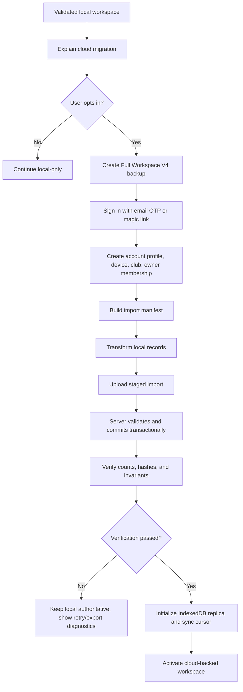

# Phase 3 Local-to-Cloud Migration and Rollback

Updated: 2026-06-25

Status: Accepted migration design baseline before Supabase provisioning

Related docs:

- `docs/ADR_PHASE_3_CLOUD_PLATFORM.md`
- `docs/PHASE_3_DURABLE_SCHEMA_DESIGN.md`
- `docs/PHASE_3_CLOUD_SYNC_IMPLEMENTATION_PLAN.md`

## 1. Purpose

This document defines how Dumala will migrate an existing local browser workspace into the Phase 3 cloud schema without deleting, replacing, or silently corrupting the user's local records.

The migration must be:

- explicit and user initiated
- non-destructive
- resumable
- idempotent
- independently verified
- reversible during beta
- compatible with existing local-only use

Cloud mode must not activate until migration verification passes.

## 2. Source and Target

### Source

The migration source is the validated local workspace currently stored through Dumala's browser persistence layer.

The source export format is Full Workspace V4:

- team information
- players
- staff
- games
- standings
- bulletins
- assessments
- payment ledger
- availability
- coach notes
- weekly training schedule
- training history
- standings snapshots and preferences
- tactics formation, lineup, roles, notes, custom positions, drawings, and player extras

Existing V1, V2, and V3 backups remain importable through the current parser, but cloud migration should operate on the normalized V4 workspace object after local validation and migration have completed.

### Target

The target is the durable PostgreSQL schema in `docs/PHASE_3_DURABLE_SCHEMA_DESIGN.md`.

The first cloud migration creates:

- one account profile
- one club
- one active owner membership
- one registered device
- one workspace import record
- normalized durable domain records
- sync change rows or an equivalent initial cursor state
- an initialized local IndexedDB replica

## 3. Migration States

Track migration state locally in IndexedDB and remotely in `workspace_imports`.

| State | Meaning | User impact |
| --- | --- | --- |
| `not_started` | User has not opted into cloud migration | Local app behaves unchanged |
| `preflight` | Local data, auth session, and browser storage are being checked | No writes to cloud domain tables yet |
| `backup_created` | Full Workspace V4 backup exists and has been offered for download | Local app remains authoritative |
| `account_ready` | User is signed in and profile/device records are ready | Local app remains authoritative |
| `club_ready` | Cloud club and owner membership exist | No domain records activated yet |
| `manifest_ready` | Import manifest and transform plan are validated | Upload can start |
| `uploading` | Records are being sent to the cloud import operation | Local app remains authoritative |
| `verifying` | Cloud counts, hashes, and invariants are being checked | Cloud mode remains locked |
| `replica_initializing` | IndexedDB replica and sync cursor are being built | Local fallback still available |
| `complete` | Cloud continuity is verified and cloud-backed mode may activate | User can use cloud-backed workspace |
| `failed` | A recoverable failure occurred | User can retry or stay local |
| `rolled_back` | User deliberately returned to the local backup during beta | Local backup becomes active again |

## 4. User Flow



Required user-facing promises:

1. Signing in does not upload data by itself.
2. Upload starts only after explicit confirmation.
3. A backup is created before upload.
4. The original browser workspace remains available during migration.
5. Failed migration does not delete local data.
6. During beta, successful migration keeps a rollback path for a defined window.

## 5. Preflight Checks

Before creating any cloud domain records:

1. Run startup storage validation.
2. Confirm the workspace can produce a valid Full Workspace V4 backup.
3. Confirm required account consent versions are accepted.
4. Confirm the user has an active Supabase Auth session.
5. Confirm the current device has or can create a stable app installation UUID.
6. Estimate browser storage availability for the IndexedDB replica.
7. Verify no existing migration for the same account and manifest is already complete.
8. Confirm the cloud feature flag is enabled for the environment.

Preflight failures must use stable error codes and must not modify local records.

## 6. Pre-Migration Backup

Create a Full Workspace V4 backup before upload.

Backup requirements:

- validate against `workspaceBackupV4Schema`
- include payment ledger entries when present
- include feature state
- include `exportedAt`
- include source app version when the backup format is extended
- offer the user a backup download before upload
- keep a local rollback reference for beta migration recovery

If backup creation fails, migration stops.

## 7. Import Manifest

The import manifest is a compact, non-secret summary of what will be uploaded.

Recommended shape:

```json
{
  "importId": "uuid",
  "sourceFormat": "dumala-workspace",
  "sourceVersion": 4,
  "sourceExportedAt": "iso timestamp",
  "sourceDeviceId": "uuid",
  "targetClubId": "uuid",
  "appVersion": "string",
  "schemaVersion": "phase-3-initial",
  "counts": {
    "players": 0,
    "staff": 0,
    "games": 0,
    "standings": 0,
    "bulletins": 0,
    "assessments": 0,
    "paymentLedgerEntries": 0
  },
  "sourceIds": {
    "players": ["uuid"],
    "staff": ["uuid"]
  },
  "hashes": {
    "workspace": "sha-256",
    "players": "sha-256"
  }
}
```

Rules:

1. Hash canonicalized data, not raw JSON text with unstable key order.
2. Do not include private record payloads in diagnostic logs.
3. Use `importId` plus source record ID as the idempotency basis.
4. Store manifest counts in `workspace_imports.record_counts`.
5. Replaying the same manifest must never create duplicate domain records.

## 8. Transform Rules

### Identity and Club

| Source | Target |
| --- | --- |
| Supabase Auth user | `user_profiles.user_id` |
| Current device installation ID | `devices.id` |
| `TeamInfo` | `clubs` |
| Auth user and club | `club_memberships` owner row |

### Roster

| Source | Target |
| --- | --- |
| `Player[]` | `players` |
| `Player.mvpHistory[]` | `mvp_awards` when not already represented by a game result |
| `Player.offenses[]` | `player_offenses` |
| `StaffMember[]` | `staff_members` |

Rules:

- Preserve existing player and staff IDs when they are valid UUIDs.
- Generate deterministic migration UUID mappings for non-UUID legacy IDs.
- Store display names as snapshots only where historical readability is needed.

### Schedule and Results

| Source | Target |
| --- | --- |
| `Game[]` | `games` |
| completed match score fields | `match_results` |
| `Game.scorers[]` | `match_scorer_contributions` |
| `Game.mvpId` | `mvp_awards` |

Rules:

- Training and meeting records import as `games` without result rows.
- Cup and friendly match results import but do not recompute league standings.
- Completed league matches must pass the same integrity checks used by the local app.

### Standings and Bulletins

| Source | Target |
| --- | --- |
| `Standing[]` | `standings_rows` |
| standings backups | `standings_snapshots` |
| `Announcement[]` | `bulletins` |

Rules:

- Preserve current displayed standings.
- Verification must compare standings against completed league match totals.

### Assessments

| Source | Target |
| --- | --- |
| `AssessmentSession[]` | `assessment_sessions` |
| `developmentPlan.weeks[]` | `assessment_development_plan_weeks` |

Rules:

- Store raw results, attribute scores, deltas, and labels.
- Add benchmark, weighting, and scoring algorithm version metadata during transform.
- Treat imported sessions as historical records, not recalculated output.

### Training, Availability, and Tactics

| Source | Target |
| --- | --- |
| availability map | `player_availability` |
| coach notes map | `coach_notes` |
| weekly training | `weekly_training_schedules` |
| weekly training history | `weekly_training_schedule_history` |
| tactics state | `tactics_workspaces` |
| lineup map | `tactics_lineup_assignments` |
| drawings | `tactics_draw_paths` |
| player extras | `tactics_player_extras` |

Rules:

- Keep bounded geometry and schedule payloads as JSONB where relational querying has no clear value.
- Validate all referenced player IDs after transform.

### Payments

| Source | Target |
| --- | --- |
| `PaymentLedgerEntry[]` | `payment_ledger_entries` |

Rules:

- Include payment entries only when the local ledger feature is enabled and validated.
- Preserve `playerNameSnapshot`.
- Import voided entries as retained history.
- Do not create online payment or accounting records.

## 9. Idempotency and Duplicate Prevention

Required idempotency keys:

| Operation | Idempotency key |
| --- | --- |
| Create cloud club for migration | `user_id + manifest_hash` |
| Create owner membership | `club_id + user_id` |
| Import source record | `import_id + source_table + source_id` |
| Apply match result import | `import_id + game_id + match_result` |
| Create sync mutation record | `club_id + device_id + idempotency_key` |

Duplicate handling:

1. A completed import with the same manifest returns the existing result.
2. An interrupted import can resume from the last committed stage.
3. A failed import cannot create a second active club silently.
4. Source ID mappings must be stable across retries.
5. Unique constraints backstop application-level checks.

## 10. Server Commit Strategy

Use a reviewed transactional import operation for the first migration.

The server operation should:

1. derive the user from the authenticated request
2. verify active ownership of the target club
3. verify the device is not revoked
4. verify the manifest has not already completed
5. validate payload shape and entity references
6. insert or upsert records using deterministic import keys
7. create initial `sync_changes` entries or a verified initial cursor
8. write `workspace_imports` status transitions
9. write redacted `audit_events`
10. commit only after all required records pass constraints

If any critical insert or invariant fails, the transaction should roll back and return a structured error code.

## 11. Verification

Verification happens after server commit and before cloud mode activates.

Compare:

- manifest counts against cloud table counts
- player and staff counts
- completed game counts
- match score and scorer integrity
- standings rows and user-team row
- player appearances, goals, clean sheets, card counts, and MVP totals
- assessment counts and player latest-assessment references
- payment ledger counts and voided entry counts
- bulletin counts
- tactics lineup player references
- weekly training and event links
- sync cursor or initial change sequence

Verification results should produce:

- `passed`
- `warning`
- `failed`

Only `passed` activates cloud-backed mode. `warning` requires explicit product decisions per warning type; it should not silently continue during the first release.

## 12. Failure Recovery

Stable error code examples:

| Code | Meaning | Recovery |
| --- | --- | --- |
| `MIGRATION_BACKUP_FAILED` | Full Workspace V4 backup could not be created | Stay local, show backup/export guidance |
| `AUTH_SESSION_REQUIRED` | User is not signed in | Resume after sign-in |
| `DEVICE_REVOKED` | Current device cannot upload | Require re-registration or support |
| `IMPORT_ALREADY_COMPLETED` | Same manifest already finished | Offer to use existing cloud workspace |
| `IMPORT_VALIDATION_FAILED` | Payload failed schema or reference validation | Stay local, offer diagnostics |
| `IMPORT_CONSTRAINT_FAILED` | Database constraint rejected a record | Stay local, support export |
| `IMPORT_INTEGRITY_FAILED` | Post-import verification failed | Keep cloud locked, offer retry/export |
| `SERVICE_UNAVAILABLE` | Network or backend unavailable | Retry safely |

Failure rules:

1. Local workspace remains authoritative until migration completes.
2. Failed uploads do not modify local records.
3. Incomplete cloud imports are marked failed or resumable.
4. Diagnostics must avoid raw player, assessment, note, and payment payloads by default.
5. The user can continue local-only after any recoverable failure.

## 13. Rollback

### Before Completion

Rollback is automatic because local storage remains authoritative. The app should:

- keep the Full Workspace V4 backup
- mark incomplete cloud import as failed or abandoned
- keep local mode active
- allow retry from the last safe stage

### After Completion During Beta

Keep a deliberate rollback window.

Rollback should:

1. warn that cloud changes after migration may not be included in the local backup
2. offer a fresh cloud export first if possible
3. require confirmation
4. restore the pre-migration Full Workspace V4 backup into local storage
5. disable cloud-backed mode on that device
6. keep the cloud club pending user decision, not silently delete it
7. write an audit event when online

Rollback should not be a normal long-term sync mode. It exists to protect beta migration safety.

## 14. IndexedDB Replica Initialization

After verification passes:

1. Create local IndexedDB stores for records, mutations, sync cursors, conflicts, migration state, and metadata.
2. Hydrate the replica from verified cloud records or from the transformed import payload plus server versions.
3. Persist the initial sync cursor.
4. Mark the local replica as cloud-backed.
5. Keep `localStorage` as read-only rollback material during the beta rollback window.
6. Route future writes through domain repositories and the mutation outbox.

The service worker must not cache authenticated API responses during or after this step.

## 15. Acceptance Criteria

The migration task is complete when:

1. A validated local workspace can create a migration manifest.
2. A Full Workspace V4 backup is created before upload.
3. User, club, owner membership, and device records are created idempotently.
4. All local core and feature records have documented transform rules.
5. Retried migration cannot duplicate records.
6. Interrupted migration can resume or fail safely.
7. Verification blocks cloud mode when counts or invariants differ.
8. Failed migration leaves the local workspace usable.
9. Successful migration initializes a local IndexedDB replica and cursor.
10. Beta rollback restores the pre-migration backup deliberately.
11. No private record payloads are written to operational logs by default.

## 16. Next Task

The next Phase 3 task is to define the offline mutation queue and conflict strategy in implementation-ready detail.

That design should specify:

- IndexedDB stores
- mutation envelope shape
- retry and backoff rules
- optimistic version checks
- conflict records
- entity-specific merge or resolution policies
- sync status UI states
- service-worker cache exclusions for authenticated responses
