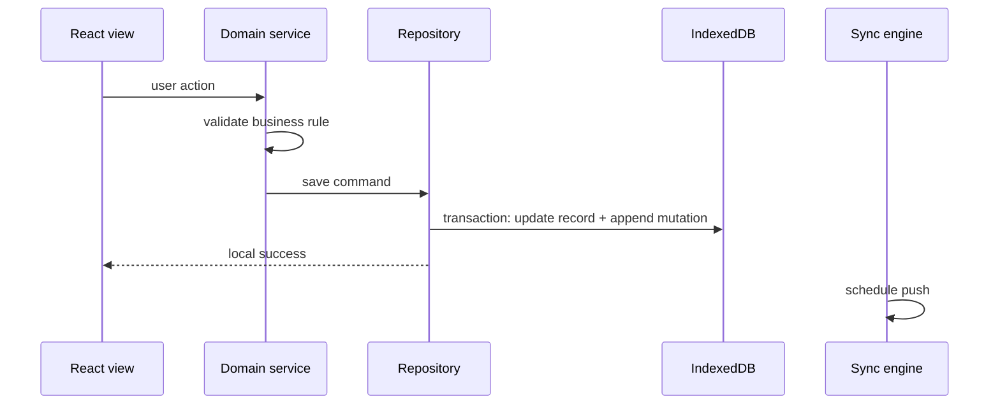
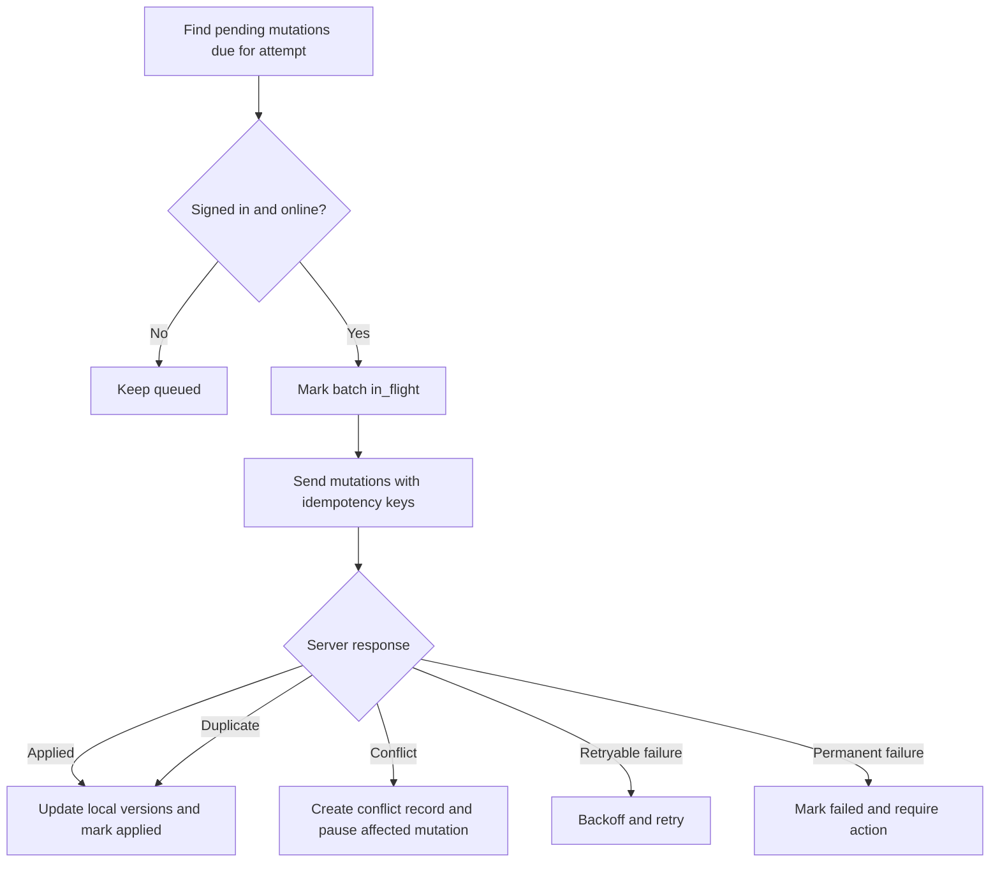

# Phase 3 Offline Mutation Queue and Conflict Strategy

Updated: 2026-06-25

Status: Accepted design baseline before implementation

Related docs:

- `docs/ADR_PHASE_3_CLOUD_PLATFORM.md`
- `docs/PHASE_3_DURABLE_SCHEMA_DESIGN.md`
- `docs/PHASE_3_LOCAL_TO_CLOUD_MIGRATION.md`

## 1. Purpose

This document defines how Dumala will keep cloud-backed work usable while offline, replay local changes safely after reconnection, and prevent stale edits from silently overwriting newer cloud data.

The design uses:

- IndexedDB as the local cloud-backed replica
- an IndexedDB mutation outbox
- idempotency keys for every pushed mutation
- server-side optimistic version checks
- explicit conflict records
- user-visible sync status

## 2. Core Principles

1. Local-only mode continues to work without an account.
2. Cloud-backed mode reads and writes through repositories, not directly from React components.
3. Every local write first updates the local replica and appends a mutation envelope.
4. Every mutation has a stable idempotency key.
5. Every update includes the server version it was based on.
6. The server rejects stale versions instead of accepting last-write-wins.
7. Conflicts are stored locally and surfaced to the user.
8. Authenticated API responses are never cached by the service worker.

## 3. IndexedDB Stores

Use one local database per app origin, with a schema versioned independently from the cloud schema.

| Store | Purpose | Key |
| --- | --- | --- |
| `records` | Local cloud-backed record replica | `table:id` |
| `mutations` | Durable pending outbox | mutation `id` |
| `sync_cursors` | Pull cursor and per-club sync metadata | `club_id` |
| `conflicts` | Unresolved conflict records | conflict `id` |
| `migration_state` | Local-to-cloud migration and rollback state | `club_id` |
| `metadata` | Device, app, schema, and feature-flag metadata | metadata key |

### `records`

Recommended record shape:

```ts
type LocalReplicaRecord = {
  key: string;
  table: string;
  id: string;
  clubId: string;
  data: unknown;
  version: number;
  deletedAt?: string;
  dirty: boolean;
  lastPulledAt?: string;
  lastPushedAt?: string;
  updatedAt: string;
};
```

Indexes:

- `clubId`
- `[clubId, table]`
- `[clubId, dirty]`
- `[clubId, deletedAt]`

### `mutations`

Recommended mutation shape:

```ts
type PendingMutation = {
  id: string;
  clubId: string;
  deviceId: string;
  idempotencyKey: string;
  table: string;
  entityId: string;
  operation: 'insert' | 'update' | 'delete' | 'function';
  baseVersion?: number;
  payload: unknown;
  createdAt: string;
  updatedAt: string;
  attemptCount: number;
  nextAttemptAt?: string;
  status: 'pending' | 'in_flight' | 'applied' | 'retrying' | 'conflict' | 'failed';
  lastErrorCode?: string;
};
```

Indexes:

- `clubId`
- `[clubId, status]`
- `[clubId, nextAttemptAt]`
- `[clubId, table, entityId]`
- unique logical constraint in app code for `[clubId, deviceId, idempotencyKey]`

## 4. Mutation Envelope

The client sends a compact mutation envelope to the sync service.

```json
{
  "mutationId": "uuid",
  "clubId": "uuid",
  "deviceId": "uuid",
  "idempotencyKey": "string",
  "table": "players",
  "entityId": "uuid",
  "operation": "update",
  "baseVersion": 7,
  "payload": {},
  "clientCreatedAt": "iso timestamp"
}
```

Rules:

1. `idempotencyKey` is generated when the local action is created and never changes during retries.
2. `baseVersion` is required for updates and deletes.
3. Inserts can use `baseVersion = 0` or omit it depending on the server function contract.
4. Function mutations name a reviewed command, such as `apply_match_result`.
5. Payloads must be validated before they enter the outbox and again on the server.

## 5. Local Write Flow



Requirements:

- Local record update and mutation append happen in one IndexedDB transaction.
- The UI may show "Saved on this device" immediately.
- The mutation remains pending until the server confirms it.
- Failed sync must not undo valid local pending work unless the user resolves a conflict.

## 6. Push Flow



Batch rules:

1. Preserve mutation order per entity.
2. Allow independent entities to sync in batches.
3. Do not send later mutations for an entity while an earlier mutation for the same entity is unresolved.
4. Treat network timeouts after send as unknown outcome; retry with the same idempotency key.
5. Mark a mutation `applied` only after the server returns an applied or duplicate-applied result.

## 7. Pull Flow

Pull uses the server cursor from `sync_changes`.

Flow:

1. Read the last cursor for the active club.
2. Fetch changes after that cursor.
3. Apply changes to local `records` in order.
4. Skip local application where a pending mutation owns the same entity and conflict detection is needed.
5. Advance the cursor only after the page is fully applied.
6. Repeat until no more pages.

Rules:

- Server sequence IDs, not device clocks, control ordering.
- Pull can run before and after push.
- Pull must be safe to repeat.
- Tombstones are retained locally long enough to propagate deletions and prevent resurrection.

## 8. Retry and Backoff

Retryable failures:

- offline
- request timeout
- `SERVICE_UNAVAILABLE`
- rate limiting
- expired access token after refresh succeeds

Permanent or action-required failures:

- revoked device
- suspended membership
- validation failure
- stale version conflict
- deleted club
- unsupported schema version

Backoff guidance:

| Attempt | Delay |
| --- | --- |
| 1 | immediate |
| 2 | 5 seconds |
| 3 | 30 seconds |
| 4 | 2 minutes |
| 5+ | capped exponential backoff with jitter |

The user can manually retry action-required sync after addressing the cause.

## 9. Conflict Record

Recommended conflict shape:

```ts
type SyncConflict = {
  id: string;
  clubId: string;
  table: string;
  entityId: string;
  mutationId: string;
  conflictType:
    | 'stale_update'
    | 'delete_vs_edit'
    | 'validation_rejected'
    | 'membership_revoked'
    | 'domain_invariant_failed';
  localVersion?: number;
  cloudVersion?: number;
  localData?: unknown;
  cloudData?: unknown;
  createdAt: string;
  resolvedAt?: string;
  resolution?: 'keep_cloud' | 'apply_local' | 'merge_manual' | 'create_copy' | 'discard_local';
};
```

Rules:

1. Store only the data required for resolution.
2. Do not show raw technical payloads as user-facing messages.
3. Keep unresolved conflicts visible in sync status.
4. Do not continue pushing dependent mutations until the conflict is resolved.

## 10. Entity-Specific Conflict Policies

| Entity | Initial strategy |
| --- | --- |
| New independent records | Merge automatically by UUID |
| Player profile | Show local and cloud field values for manual resolution |
| Staff profile | Show local and cloud field values for manual resolution |
| Bulletins | Preserve both versions or let user choose one |
| Coach notes | Preserve both versions and support manual merge |
| Games before result completion | Manual resolution for stale edits |
| Match result | Reject stale update and reopen result editor |
| Scorer contributions | Managed only through match-result command |
| Standings rows | Recompute from accepted league results where possible |
| Assessment sessions | Treat as immutable; corrections create a superseding session |
| Development plans | Follow parent assessment session |
| Payment ledger entries | Additive entries merge by UUID; void conflicts require manual review |
| Tactics workspace | Treat as one versioned snapshot initially |
| Tactics drawings | Preserve conflicting copies rather than attempting geometric merge |
| Delete versus edit | Require explicit restore, keep deletion tombstone, or discard local edit |

## 11. Domain Commands

Some local actions should sync as commands rather than raw table updates.

Use command mutations for:

- applying a match result
- editing a completed match result
- reversing a completed match result
- bulk importing a workspace
- bulk charging active players when payments are cloud-backed
- account or club deletion workflows

Command mutations must be implemented server-side transactionally and must return:

- applied status
- affected entity IDs
- resulting versions
- stable error codes
- conflict details when rejected

## 12. Sync Status UI States

Use compact states across the app:

| State | Meaning |
| --- | --- |
| `Saved on this device` | Local write completed, not yet synced |
| `Syncing` | Push or pull is active |
| `Synced` | No pending local mutations and latest cursor is applied |
| `Offline, changes queued` | Browser is offline or service unavailable |
| `Sign-in required` | Session is missing or expired |
| `Sync paused` | Device, membership, schema, or feature flag prevents sync |
| `Action required` | Permanent failure requires user choice |
| `Conflict requires review` | One or more unresolved conflicts exist |

The user must be able to:

- see pending mutation count
- retry failed synchronization
- review conflict summaries
- export a backup before risky recovery actions
- keep working offline when failures are recoverable
- sign out without accidentally deleting unsynced local data

## 13. Sign-Out and Account Switching

Sign-out must handle pending changes explicitly.

If no pending mutations or conflicts exist:

- clear the auth session
- keep or clear local cloud replica according to the user's choice

If pending mutations or conflicts exist:

- warn the user
- offer retry sync
- offer local backup export
- allow sign-out only after explicit confirmation
- preserve the local replica unless the user deliberately removes it

Account switching on a shared device must never merge two users' private replicas.

## 14. Service Worker and Cache Rules

The service worker may cache deployable app assets only.

It must not cache:

- Supabase API responses
- authenticated REST responses
- auth callback payloads
- access tokens
- refresh tokens
- workspace import payloads
- export downloads
- private profile, roster, assessment, payment, or tactics data

Cloud requests should use network-only behavior outside Workbox runtime caches.

## 15. Testing Requirements

Unit tests:

- mutation envelope validation
- idempotency key stability
- retry and backoff calculation
- per-entity queue ordering
- conflict classification
- cursor advancement rules

Integration tests:

- offline create, refresh, reconnect, sync
- timeout after server commit and retry with same idempotency key
- duplicate mutation replay
- stale update conflict
- delete versus edit conflict
- rejected match-result command
- sign-out with pending mutations
- account switch isolation

Browser/PWA tests:

- offline startup with cloud-backed replica
- queued mutation survives refresh and browser restart
- authenticated responses absent from Cache Storage
- sync status updates across desktop, mobile, and tablet widths

## 16. Acceptance Criteria

The offline mutation queue task is complete when:

1. IndexedDB stores and record shapes are defined.
2. Mutation envelope shape is defined.
3. Local write, push, and pull flows are documented.
4. Retry, backoff, and action-required failures are classified.
5. Conflict records and entity policies are defined.
6. Domain commands are separated from raw table updates.
7. Sync status UI states are defined.
8. Sign-out and account-switch behavior preserves unsynced data.
9. Service-worker cache exclusions are explicit.
10. Required tests are listed for implementation.

## 17. Next Task

The next Phase 3 task is to define account recovery, data export, and deletion.

That design should cover:

- passwordless account recovery assumptions
- device revocation
- session management
- cloud workspace export
- account and club deletion states
- re-authentication requirements
- recovery windows
- retention rules
- audit events
